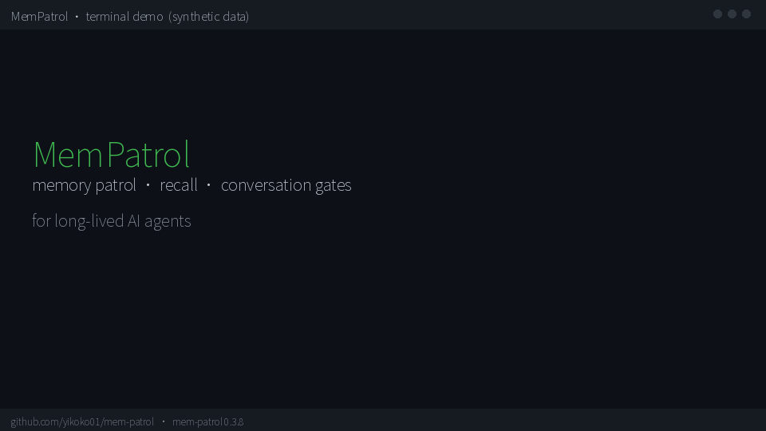
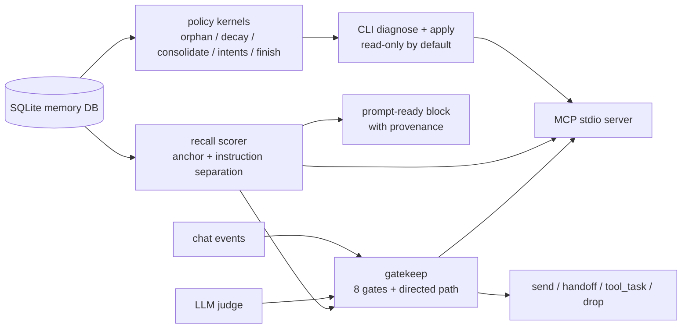

# MemPatrol

[](https://github.com/yikoko01/mem-patrol/actions/workflows/ci.yml)
[](https://pypi.org/project/mem-patrol/)
[](https://pypi.org/project/mem-patrol/)
[](LICENSE)

English | [中文](README.zh.md)

MemPatrol is a dependency-free toolkit for **long-lived AI agents**: memory hygiene
(patrol), prompt-ready recall, and a judge-first conversation gate. It runs on plain
SQLite, ships a CLI and a read-only MCP server, and does not depend on an IM framework.

```text
SQLite memories ──► patrol / diagnose ──► auditable repairs (--apply + backup)
        │
        ├──────────► recall scorer ─────► prompt-ready memory block
        │                                      │
chat events ──► gatekeep ◄────────────────────┘
        └────► LLM judge ──► send / handoff / tool_task / drop
```

## Why MemPatrol

- **Deterministic by default.** Audits, decay/consolidation plans, intent expiry and
  finish gates are pure functions. The LLM only appears where a human would otherwise
  hand-edit memory.
- **Judge-first interjection.** A small set of hard gates rejects the obvious
  "not now"; after that, the LLM judge decides whether there is a natural insertion
  point. Throttling limits rate, it does not silently veto.
- **Portable.** One memories table is enough. Map any SQLite schema with `--schema`,
  or let `--schema auto` inspect it. `jieba` is optional.
- **Boring operations.** Read-only by default; writes require `--apply` and take a
  snapshot first. Every release has offline eval and a real-corpus replay gate.
- **No host lock-in.** No AstrBot/QQ/Telegram types in the kernels. Any adapter can
  build the small `Context`/rows structures.



## Architecture



Full component map: [`docs/ARCHITECTURE.md`](docs/ARCHITECTURE.md).

## Install

```bash
pip install mem-patrol                 # from PyPI
# or: python -m pip install .
memorix --version                      # mem-patrol 0.3.1
```

The distribution is `mem-patrol`; the import package and original CLI remain
`memorix` for compatibility. `mem-patrol` / `mem-patrol-mcp` are aliases.

## Quickstart

```bash
# read-only diagnosis (works with any schema)
memorix diagnose --db messages.db --schema auto

# plan before writing; --apply creates a DB snapshot first
memorix decay --db messages.db
memorix decay --db messages.db --apply

# offline regression
python -m memorix.eval --suite all --baseline eval/baseline.json
python -m memorix.retrieval.bench      # 6/6
python -m memorix.gatekeep.bench       # 9/9
```

## End-to-end: group-chat interjection

```python
from memorix.gatekeep import Context, decide
from memorix.retrieval.context import recent_private_context
from memorix.retrieval.score import recall
from memorix.retrieval.store import load_rows

rows = load_rows("messages.db")
context = recent_private_context("messages.db", user_id)
memory = recall(user_message, rows=rows, context=context, user_id=user_id)

outcome = decide(
    Context(
        text=user_message,
        user_id=user_id,
        config={
            "enable_group_interjection": True,
            "group_interject_max_daily": 30,
            "group_interject_judge_min_consult_seconds": 10,
            "group_interject_min_interval_minutes": 1,
        },
    ),
    judge=llm_judge,  # returns {"should_reply": bool, "text": ..., "needs_tools": ...}
)
if outcome.action == "sent":
    send(outcome.text)
```

The judge is only called after the cheap gates pass. Directed messages (@/reply/name)
take a fast path. Step-by-step walkthrough: [`docs/END-TO-END.md`](docs/END-TO-END.md).

## Recall backends (lexical default, vector optional)

```python
from memorix.retrieval.provider import make_provider

provider = make_provider("lexical")                 # default, zero deps
# provider = make_provider("vector", embedder=embed_batch)  # bring your own embeddings
block = provider.recall(user_message, rows=rows, context=context, user_id=user_id)
```

`VectorProvider` is an **optional** path (cosine + embedding cache); no model is bundled.
The ONNX adapter is in `memorix.retrieval.vector_onnx` (`pip install 'mem-patrol[vector]'`).
Lexical remains the default until vector wins on the real corpus without regressions.

## MCP

```json
{
  "mcpServers": {
    "memorix": {
      "command": "memorix-mcp",
      "args": ["--profile", "both", "--db", "/path/to/messages.db"]
    }
  }
}
```

Six **read-only** tools: `memorix_diagnose`, `memorix_orphan`, `memorix_recall`,
`memorix_gate_check`, `memorix_judge_replay`, `memorix_eval`. See [`docs/MCP.md`](docs/MCP.md).

## Two modes

| profile | what it is for | MCP tools |
|---|---|---|
| `chat` | recall + gatekeep, no patrol writes | recall / gate_check / judge_replay |
| `project` | patrol, diagnose, recall, eval | diagnose / orphan / recall / eval |
| `both` | both kernels, judge-first with light throttle | all 6 |

```bash
python -m memorix.profiles --list
memorix profile --name chat
```

## Any SQLite schema

```bash
memorix diagnose --db my.db --schema schema.json   # explicit mapping
memorix diagnose --db my.db --schema auto          # auto-detect
MEMORIX_SCHEMA=schema.json memorix diagnose --db my.db
```

Only `memories` is required; `status`/`finish` report a clear `SchemaError` if message
tables are not mapped. A privacy-preserving real-corpus replay is in
[`eval/real_corpus.json`](eval/real_corpus.json): [`docs/REAL-CORPUS.md`](docs/REAL-CORPUS.md).

## Quality and benchmarks

- **374 tests**; CI on Python 3.10 / 3.11 / 3.12.
- Synthetic §10.3 replay: **6/6**; real production replay: **6/6 current**,
  **5/6 historical** (one data gap documented, not an algorithm failure).
- On a 1,238-memory read-only snapshot: cold load ~**0.18 s**, warm recall median
  ~**43 ms**, injected block ~**620 chars**. Environment-specific; see
  [`docs/BENCHMARKS.md`](docs/BENCHMARKS.md).

## CI/CD

- `.github/workflows/ci.yml` — pytest + both benches + eval on Python 3.10/3.11/3.12.
- `.github/workflows/release.yml` — `v*` tag → test, build wheel/sdist, install smoke, GitHub Release assets.
- `.github/workflows/publish.yml` — manual PyPI upload via trusted publishing (OIDC; no token in secrets).

## Docs

- [Contributing](CONTRIBUTING.md) · [Roadmap](ROADMAP.md)
- [Use cases](docs/USE-CASES.md) · [Architecture](docs/ARCHITECTURE.md) ·
  [End-to-end](docs/END-TO-END.md) · [Schema](docs/SCHEMA.md) ·
  [MCP](docs/MCP.md) · [Interjection](docs/INTERJECTION.md) ·
  [Real corpus](docs/REAL-CORPUS.md) · [Comparison](docs/COMPARISON.md) ·
  [Benchmarks](docs/BENCHMARKS.md) · [Vector design](docs/VECTOR-PROVIDER.md) · [Release](docs/RELEASE.md) · [FAQ](docs/FAQ.md)

## License

MIT. See [`LICENSE`](LICENSE). MIT was chosen for minimal adoption friction; it has no explicit patent grant (Apache-2.0, used by 0.2.0/0.2.1, does). See [`FAQ.md`](docs/FAQ.md).
