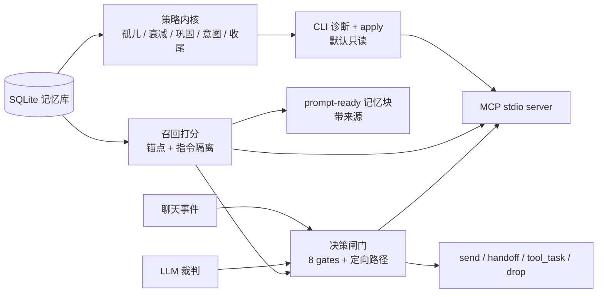

# MemPatrol · 记忆巡检、召回与接话闸门

[](https://github.com/yikoko01/mem-patrol/actions/workflows/ci.yml)
[](https://pypi.org/project/mem-patrol/)
[](https://pypi.org/project/mem-patrol/)
[](LICENSE)

[English](README.md) | 中文

MemPatrol 是给**长期运行的 AI agent** 用的零依赖工具包：记忆巡检、可直接注入 prompt 的召回，
以及“裁判优先”的接话闸门。它跑在普通 SQLite 上，带 CLI + 只读 MCP server，
不绑定任何 IM 框架。

```text
SQLite 记忆 ──► 巡检/诊断 ──► 可审计修复（--apply + 自动备份）
        │
        ├──────────► 召回打分 ─────► prompt-ready 记忆块
        │                                │
聊天事件 ──► 决策闸门 ◄──────────────────┘
        └────► LLM 裁判 ──► sent / handoff / tool_task / drop
```

<p align="center"></p>

## 10 秒安装

```bash
pip install mem-patrol
memorix --version        # 主 CLI；`mem-patrol` 是别名，import 仍是 `memorix`
```

## 为什么是 MemPatrol

- **默认确定性**：审计、衰减/巩固计划、意图过期、收尾闸门都是纯函数；LLM 只出现在
  “提炼/判定”这一格，不替代码做状态管理。
- **裁判优先的接话**：少量硬闸只挡“明显不该说”；过闸后由裁判判断有没有自然插入点。
  节流只管频率，不静默否决。
- **可移植**：一张 memories 表就能用；任意 SQLite schema 用 `--schema` 映射，
  或 `--schema auto` 自动探测。`jieba` 是可选依赖。
- **运维友好**：默认只读，写操作必须 `--apply` 且先快照；每个 release 有离线 eval
  和真实库回放门。
- **不绑宿主**：内核里没有 AstrBot/QQ/Telegram 类型；适配器只需构造
  `Context` 和行数据。

## 零 LLM 路径

大部分能力不需要模型：`memorix diagnose/recall/eval`、所有 MCP 工具、召回打分，以及
不传 judge 的 `decide(ctx)` 都可离线运行。`decide` 无 judge 时经过确定性闸门后返回
`candidate`；只在最终“说不说”时接宿主 judge。见 [`docs/ZERO-LLM.md`](docs/ZERO-LLM.md)。

## 架构



详细组件见 [`docs/ARCHITECTURE.md`](docs/ARCHITECTURE.md)。

## 安装

```bash
pip install mem-patrol                 # PyPI
# 或：python -m pip install .
memorix --version                      # mem-patrol 0.3.9
```

发行名是 `mem-patrol`；导入包和原 CLI 仍是 `memorix`，另有 `mem-patrol` /
`mem-patrol-mcp` 别名。

## 快速开始

```bash
# 只读诊断（任意 schema）
memorix diagnose --db messages.db --schema auto

# 先看计划；--apply 才会写，并自动快照
memorix decay --db messages.db
memorix decay --db messages.db --apply

# 离线回归
python -m memorix.eval --suite all --baseline eval/baseline.json
python -m memorix.retrieval.bench      # 6/6
python -m memorix.gatekeep.bench       # 9/9

# prompt-ready 召回（lexical，不走 LLM）
memorix recall --db messages.db --query "为什么说 8-23 比 8-19 更难" --user-id <id>
```

## 端到端：群聊接话

```python
from memorix.gatekeep import Context, decide
from memorix.retrieval.context import recent_private_context
from memorix.retrieval.score import recall
from memorix.retrieval.store import load_rows

rows = load_rows("messages.db")
context = recent_private_context("messages.db", user_id)
memory = recall(user_message, rows=rows, context=context, user_id=user_id)

outcome = decide(
    Context(
        text=user_message,
        user_id=user_id,
        config={
            "enable_group_interjection": True,
            "group_interject_max_daily": 30,
            "group_interject_judge_min_consult_seconds": 10,
            "group_interject_min_interval_minutes": 1,
        },
    ),
    judge=llm_judge,  # 返回 {"should_reply": bool, "text": ..., "needs_tools": ...}
)
if outcome.action == "sent":
    send(outcome.text)
```

裁判只在便宜闸门通过后调用；@/回复/叫名字走定向快路径。完整流程见
[`docs/END-TO-END.md`](docs/END-TO-END.md)。

## 召回后端（默认为 lexical，可选 vector）

```python
from memorix.retrieval.provider import make_provider

provider = make_provider("lexical")                 # 默认，零依赖
# provider = make_provider("vector", embedder=embed_batch)  # 自带 embedding
block = provider.recall(user_message, rows=rows, context=context, user_id=user_id)
```

`VectorProvider` 是**可选**路径（cosine + embedding 缓存），不内置模型。
ONNX 适配器在 `memorix.retrieval.vector_onnx`（`pip install 'mem-patrol[vector]'`）。
在真实库上不输给 lexical 之前，默认不变。

## 词法边界（同义词要诚实）

lexical 召回不认识同义词。用内置示例，下面两问都会返回 `(empty)`：

- 记忆“喜欢喝冰美式” → 查询“咖啡”
- 记忆“想学吉他” → 查询“音乐”

这是预期行为，不是 bug；默认就是 lexical。vector 是可选 provider seam
（`make_provider("vector", embedder=...)`），不内置模型。见 [`docs/VECTOR-PROVIDER.md`](docs/VECTOR-PROVIDER.md)。

## MCP

```json
{
  "mcpServers": {
    "memorix": {
      "command": "memorix-mcp",
      "args": ["--profile", "both", "--db", "/path/to/messages.db"]
    }
  }
}
```

6 个**只读**工具（显式声明 `readOnlyHint`/`destructiveHint`/`idempotentHint`/`openWorldHint`）：`memorix_diagnose`、`memorix_orphan`、`memorix_recall`、
`memorix_gate_check`、`memorix_judge_replay`、`memorix_eval`。见 [`docs/MCP.md`](docs/MCP.md)。

## 两种模式

| profile | 用途 | MCP 工具 |
|---|---|---|
| `chat` | 召回 + 闸门，不跑巡检写操作 | recall / gate_check / judge_replay |
| `project` | 巡检、诊断、召回、评测 | diagnose / orphan / recall / eval |
| `both` | 两个内核；裁判优先 + 轻节流 | 全部 6 个 |

```bash
python -m memorix.profiles --list
memorix profile --name chat
```

## 任意 SQLite schema

```bash
memorix diagnose --db my.db --schema schema.json   # 显式映射
memorix diagnose --db my.db --schema auto          # 自动探测
MEMORIX_SCHEMA=schema.json memorix diagnose --db my.db
```

只有 `memories` 是必需的；缺消息表时 `status`/`finish` 会给出明确 `SchemaError`。
真实库回归见 [`eval/real_corpus.json`](eval/real_corpus.json) 和
[`docs/REAL-CORPUS.md`](docs/REAL-CORPUS.md)。

## 质量与基准

- **388 tests**；CI 覆盖 Python 3.10 / 3.11 / 3.12。
- §10.3 合成回放 **6/6**；真实库回放 **current 6/6**、**historical 5/6**
  （一个数据缺口，不是算法 fail）。
- 1,238 条记忆的只读快照：冷加载 ~**0.18 s**，热召回中位 ~**43 ms**，
  注入块 ~**620 chars**。环境相关，见 [`docs/BENCHMARKS.md`](docs/BENCHMARKS.md)。

## `doctor`：ok 与 clean 的区别

`memorix doctor` 把“能不能跑”和“环境干不干净”分开：

- `ok` — 导入和入口正常；这是**可运行**信号。
- `clean` — `ok` 且没有 warnings；这是**环境/CI**信号。
- `warnings[]` — 非致命残留（如重复 stale dist-info、软链包目录）。
- `--strict` — 有 warning 就 exit 1，给 CI 用。

```bash
memorix doctor            # OK / WARN / FAIL
memorix doctor --json     # 脚本读 ok、clean、warnings
memorix doctor --strict   # CI：有残留直接失败
```

只读 `ok` 的脚本可能放过“能用但环境脏”；在意环境时用 `clean` 或 `--strict`。

## CLI 报错：默认对用户说话

库不存在、schema 错、状态文件错统一为一行错误 + 提示，退出码 4；`diagnose` 和
`recall` 行为一致：

```text
ERROR: 找不到数据库: /tmp/nope.db
HINT: 检查 --db 路径；本次是只读操作，不会修改任何数据库。
```

开发时加 `--debug`（或 `MEMORIX_DEBUG=1`）显示原始异常类型和 traceback。路径错不该
让用户读一屏 traceback。

## CI/CD

- `.github/workflows/ci.yml` — Python 3.10/3.11/3.12 上跑 pytest + 两个 bench + eval。
- `.github/workflows/release.yml` — `v*` tag → 测试、构建 wheel/sdist、安装 smoke、发 GitHub Release。
- `.github/workflows/publish.yml` — 手动触发 PyPI 上传，走 trusted publishing（OIDC，不需要在 secret 里放 token）。

## 文档

- [贡献指南](CONTRIBUTING.md) · [路线图](ROADMAP.md)
- [用例](docs/USE-CASES.md) · [架构](docs/ARCHITECTURE.md) ·
  [端到端](docs/END-TO-END.md) · [Schema](docs/SCHEMA.md) · [接入测试](docs/INTEGRATION.md) · [Integration](docs/INTEGRATION.md) ·
  [MCP](docs/MCP.md) · [接话策略](docs/INTERJECTION.md) ·
  [真实库回归](docs/REAL-CORPUS.md) · [对比](docs/COMPARISON.md) ·
  [基准](docs/BENCHMARKS.md) · [向量设计](docs/VECTOR-PROVIDER.md) · [发布](docs/RELEASE.md) · [FAQ](docs/FAQ.md)

## 社区

- [Discussions](https://github.com/yikoko01/mem-patrol/discussions) · [Community guide](docs/COMMUNITY.md)：用例、问答、show-and-tell。
- [贡献指南](CONTRIBUTING.md) · [路线图](ROADMAP.md) · [Issue 模板](.github/ISSUE_TEMPLATE)。

## License

MIT，见 [`LICENSE`](LICENSE)。选 MIT 是为了最低的采用门槛；它没有显式专利授权（0.2.0/0.2.1 的 Apache-2.0 有）。详见 [`FAQ.md`](docs/FAQ.md)。
