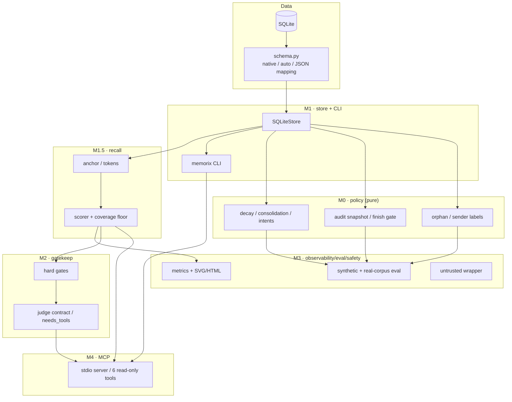
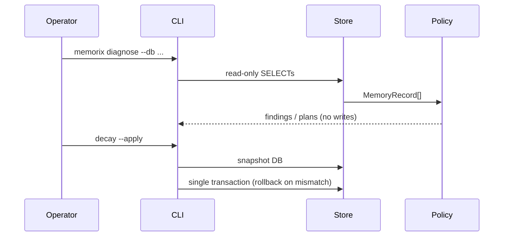
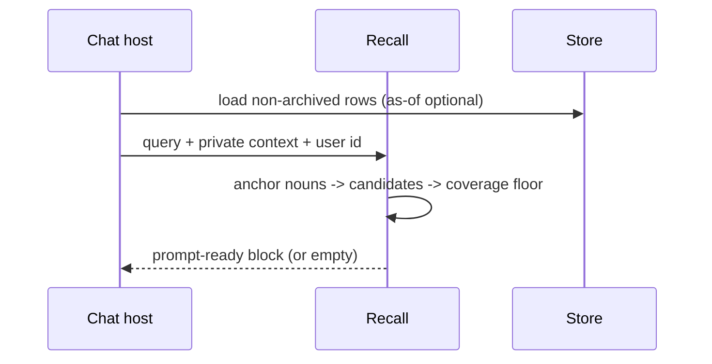
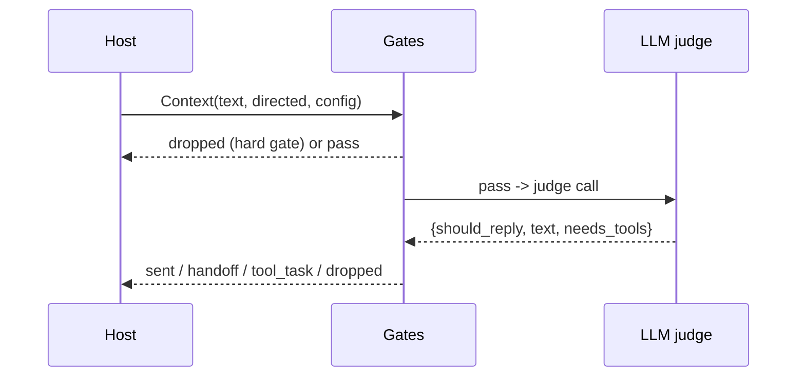

# Architecture

MemPatrol is deliberately split into small layers so a host adapter can reuse one
piece without the rest.

## Data flow

### Patrol / long-term project

### Recall

### Interjection

## Modules

| Path | Responsibility |
|---|---|
| `policy/` | pure M0 functions: orphan, sender labels, audit, finish, decay, consolidation, intents |
| `store.py` | SQLite adapter + schema mapping; read-only unless `readonly=False` |
| `cli.py` | diagnose/plan/apply commands; `--apply` is the only write entry |
| `retrieval/` | anchor selection, lexical scorer, private context, §10.3 benches |
| `gatekeep/` | gates, judge JSON contract, needs_tools routing, shadow/reviewers |
| `observability/` | metrics + zero-dep SVG/HTML report |
| `eval/` | synthetic suites + baseline + privacy-preserving real-corpus check |
| `safety/` | untrusted text wrapper (structure, not semantic filtering) |
| `mcp/` | JSON-RPC 2.0 stdio server; tools are read-only |
| `profiles.py` | chat/project/both presets (defaults, not locks) |

## Invariants

1. **No writes without `--apply`**, and `--apply` snapshots first.
2. MCP has no write tool; repair stays in the CLI.
3. `query` and `instruction` are separate; instruction text never ranks.
4. Contract/preference memories are not injected without an anchor hit.
5. `archived` is excluded from recall, not from diagnosis counts.
6. A schema without message tables still supports memory-only features and fails
   message features with a clear `SchemaError`.
