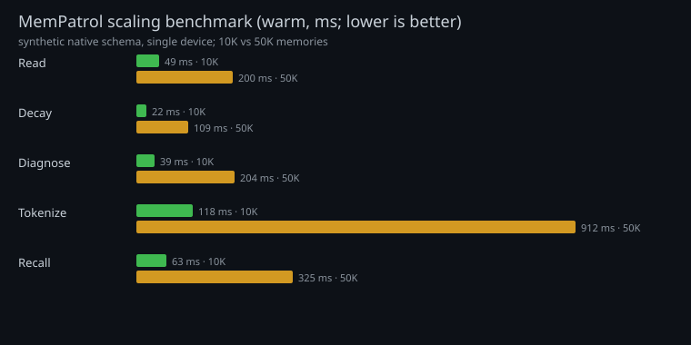

# Benchmarks and quality gates

No marketing numbers here: these are measured on a read-only snapshot of a real
SQLite memory store, on the development device (ARM64, Python 3.12). Re-run with the
commands below on your hardware.

## Corpus

| item | value |
|---|---|
| memories | 1,254 (1,238 after excluding `archived`) |
| raw_messages | 4,079 |
| bot_messages | 6,173 |
| schema | explicit mapping (`examples/self-learning.schema.json`) |

## Latency / size

| metric | value | notes |
|---|---|---|
| cold load (`load_rows`) | **~184 ms** | includes tokenization + jieba warm-up |
| warm recall (median) | **~43 ms** | 5 runs, same process, 1,238 rows |
| first recall after load | up to ~2 s in one run | jieba anchor initialization; not steady-state |
| prompt-ready block | **618 chars** | case 1, `max_chars=900`, top-5 cap |

```bash
python - <<'PY'
import time, statistics
from memorix.retrieval.store import load_rows
from memorix.retrieval.score import recall
from memorix.retrieval.context import recent_private_context
db="messages.db"; schema="examples/self-learning.schema.json"; user="<user-id>"
q="我们最开始因为什么开启这个项目，最开始的困难是什么"
t=time.perf_counter(); rows=load_rows(db,schema=schema); print("load_ms", (time.perf_counter()-t)*1000)
ctx=recent_private_context(db,user,limit=4,schema=schema)
times=[]
for _ in range(5):
    t=time.perf_counter(); recall(q,rows=rows,context=ctx,user_id=user,top_k=5,max_chars=900)
    times.append((time.perf_counter()-t)*1000)
print("median_ms", statistics.median(times))
PY
```

## Quality gates

| gate | result |
|---|---|
| unit/integration tests | **381 passed** |
| synthetic §10.3 replay | **6/6** |
| real replay, current snapshot | **6/6** |
| real replay, historical point-in-time | **5/6 + 1 documented data gap** |
| eval suites (recall/judge/policy) | **24/24** |

The historical gap is `case3-versions`: at that timestamp the corpus had no memory
comparing 8-19 with 8-23. Adding a memory later cannot rewrite history; that is a data
gap, not a scorer failure. See `verify/prod-replay-20261021.md`.

## What is *not* measured

- No large-scale accuracy benchmark or leaderboard claim.
- Lexical recall only; no embedding/vector quality comparison yet.
- Numbers depend on Python/jieba/CPU and will differ on other machines.

## Scaling: 10K / 50K synthetic memories




`scripts/bench_scale.py` builds a synthetic native-schema DB, then measures
read/plan/diagnose/recall. Warm recall excludes the first jieba/anchor call; each
number is this device, single run (not a statistically rigorous benchmark).

| operation | 10K rows | 50K rows | 100K rows |
|---|---:|---:|---:|
| `iter_memories` (read) | ~49 ms | ~200 ms | ~354 ms |
| `plan_decay` | ~22 ms | ~109 ms | ~157 ms |
| `build_diagnosis` (no state/audit) | ~39 ms | ~204 ms | ~1.26 s |
| `load_rows` (tokenize) | ~118 ms | ~912 ms | ~1.31 s |
| warm `recall` (top 5) | ~63 ms | ~325 ms | ~559 ms |

```bash
python scripts/bench_scale.py --rows 10000 --json
python scripts/bench_scale.py --rows 50000 --json
```

Diagnosis/decay are linear and fast; the tokenization/load step dominates scaling.
### When to move beyond plain SQLite

- **≤10K**: single-file SQLite + lexical is comfortable; diagnosis is tens of ms.
- **10K–100K**: still workable; diagnosis/load grow to ~1s. Cache tokenized rows or run
  diagnosis off the request path.
- **>100K or multi-tenant semantic recall**: SQLite is a fine *source of truth*, but add an
  ANN/vector index (or a service) for the retrieval path; keep the deterministic patrol
  on SQLite. The interface is already `BaseRecallProvider`, so this is a provider swap,
  not a rewrite.

For 50K+ rows, cache tokenized rows or add the planned vector/ANN path.
